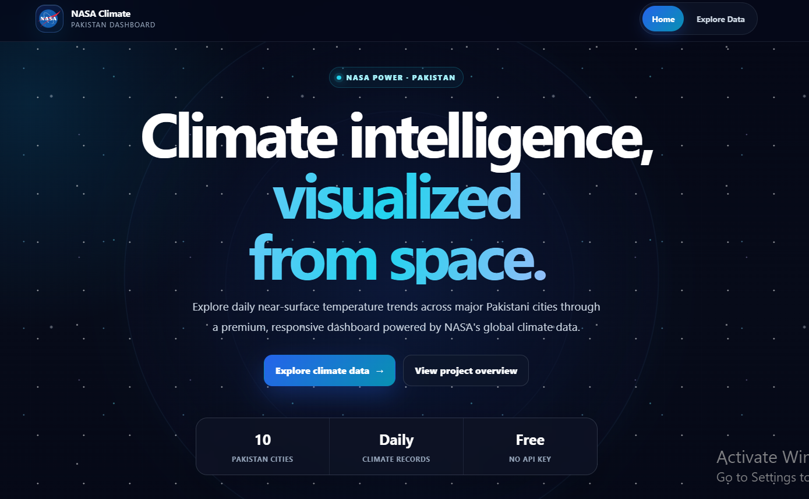
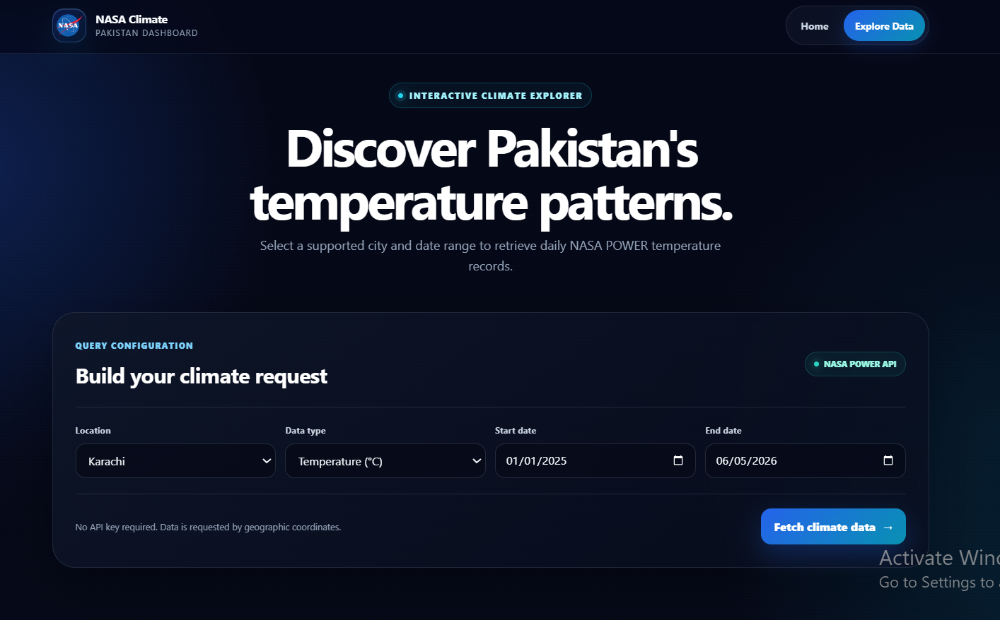
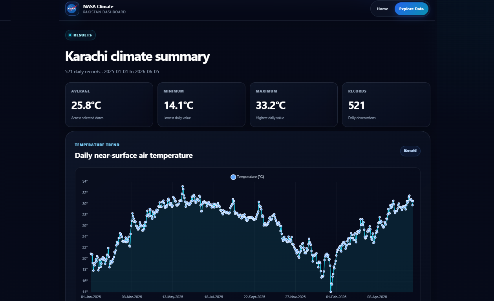

<h1 align="center">🛰️ NASA Pakistan Climate Dashboard</h1>

<p align="center">
  <b>A premium, responsive full-stack climate data dashboard built with .NET 9 Web API, Angular 21, TypeScript 5.9, Chart.js, SCSS, NASA POWER integration, and Docker support.</b>
</p>

<p align="center">
  
  
  
  
  
  
  
</p>

---

## 📸 Project Screenshots

| Homepage |
|---|
|  | 

| Filteration | Result |
|---|---|
|  |  |

### Screenshot Files

```text
docs/screenshots/
├── home.png
├── analyze.png
└── result.png
```
---

## 🚀 Project Overview

**NASA Pakistan Climate Dashboard** is a full-stack climate visualization application that retrieves daily near-surface air temperature records for major Pakistani cities from the globally available **NASA POWER API**.

The system combines a modern **Angular 21 standalone frontend** with an **ASP.NET Core 9 Web API backend**. Users can select a supported Pakistani city, choose a date range, retrieve NASA climate records, review summary metrics, explore a responsive line chart, and browse formatted daily observations.

This project is intentionally designed as an ideal beginner-to-intermediate portfolio application. It demonstrates real external API integration, dependency injection, asynchronous C# services, REST endpoints, typed Angular services, responsive UI engineering, chart visualization, testing, and Docker-based backend packaging without unnecessary enterprise complexity.

---

## 🎯 Project Purpose

Climate and Earth-observation datasets are often difficult to explore directly through raw JSON responses. This dashboard provides a focused interface that converts NASA POWER daily point data into an understandable city-based experience.

**NASA Pakistan Climate Dashboard** is designed to showcase practical full-stack development skills using **.NET 9**, **Angular 21**, **TypeScript 5.9**, **Chart.js**, **SCSS**, **Vitest**, and the **NASA POWER API**.

---

## 🎯 Key Highlights

- 🛰️ Real NASA POWER climate-data integration
- 🇵🇰 Ten supported Pakistani cities with geographic coordinates
- 🌡️ Daily near-surface air temperature visualization
- 📅 Custom start and end date selection
- 📈 Responsive Chart.js line chart
- 📊 Average, minimum, maximum, and record-count summaries
- 📄 Formatted and paginated daily records
- ⚡ ASP.NET Core typed `HttpClient` registration
- 🔌 Angular typed HTTP service and query parameters
- 🧭 Angular standalone routing
- ✨ Premium star-field hero built entirely with CSS
- 🪟 Glassmorphism cards and modern dark-space visual system
- ♿ Accessible labels, focus states, skip link, and status messages
- 📱 Responsive layouts for small phones, mobile, tablet, laptop, desktop, and wide screens
- 🧪 Angular Vitest unit tests
- 🐳 .NET 9 backend Dockerfile
- 📘 Swagger/OpenAPI documentation
- 🔑 No API key or paid climate-data subscription required

---

## ✨ Features

### 🌍 Climate Explorer Features

| Feature | Description |
|---|---|
| City Selection | Select one of ten predefined Pakistani cities |
| Date Range | Choose custom start and end dates |
| Temperature Data | Retrieve the NASA POWER `T2M` daily parameter |
| Automatic Initial Query | Loads the first available city after the locations endpoint responds |
| Summary Metrics | Calculates average, minimum, maximum, and total records in the frontend |
| Trend Chart | Displays a responsive daily line chart using Chart.js |
| Daily Records | Formats NASA date keys into readable Pakistan-localized dates |
| Pagination | Displays 20 daily observations per page |
| Loading State | Shows a premium API-connection progress state |
| Error State | Presents clear guidance when the backend or NASA request fails |
| Empty State | Handles valid queries that return no daily records |

---

### 🎨 Premium UI/UX Features

| Feature | Description |
|---|---|
| CSS Star Field | Animated multi-layer star background without a hero image |
| Orbital Effects | Responsive orbital rings and ambient climate-data glow |
| Glassmorphism | Consistent translucent navigation, forms, cards, and result panels |
| Fluid Typography | Uses CSS `clamp()` for screen-aware headings and body copy |
| Responsive Navigation | Wraps into a full-width mobile navigation control |
| Responsive Forms | Four columns on large screens, two on tablets, one on mobile |
| Responsive Metrics | Four cards on desktop, two on tablet, one on mobile |
| Responsive Records | Two-column observations on desktop and one column on mobile |
| Accessible Interactions | Keyboard focus styling, semantic labels, status roles, and skip navigation |
| Reduced Motion | Honors the user's `prefers-reduced-motion` setting |

---

### 🔌 Backend API Features

| Feature | Description |
|---|---|
| Health Endpoint | Confirms that the ASP.NET Core API is running |
| Locations Endpoint | Returns supported Pakistani city names |
| NASA Data Endpoint | Resolves coordinates and requests NASA POWER daily data |
| Dependency Injection | Registers `NasaDataService` through `AddHttpClient` |
| Async Communication | Calls NASA POWER asynchronously through `HttpClient` |
| Swagger | Provides interactive development API documentation |
| CORS | Allows the local Angular frontend at `http://localhost:4200` |
| Docker | Includes multi-stage .NET 9 SDK/runtime backend images |

---

## 🇵🇰 Supported Cities

| City | Latitude | Longitude |
|---|---:|---:|
| Karachi | 24.8607 | 67.0011 |
| Lahore | 31.5204 | 74.3587 |
| Islamabad | 33.6844 | 73.0479 |
| Rawalpindi | 33.5651 | 73.0169 |
| Faisalabad | 31.4504 | 73.1350 |
| Multan | 30.1575 | 71.5249 |
| Peshawar | 34.0151 | 71.5249 |
| Quetta | 30.1798 | 66.9750 |
| Hyderabad | 25.3960 | 68.3578 |
| Gilgit | 35.9208 | 74.3089 |

---

## 🛠 Tech Stack

| Layer | Technologies |
|---|---|
| Backend | .NET 9, ASP.NET Core Web API, C# |
| External Data | NASA POWER Daily Point API |
| API Documentation | Swagger / Swashbuckle 10.2 |
| HTTP Integration | Typed ASP.NET Core `HttpClient` service |
| Frontend | Angular 21 standalone components |
| Language | TypeScript 5.9 |
| UI / Styling | SCSS, responsive CSS Grid/Flexbox, glassmorphism, CSS animations |
| Charts | Chart.js 4.5, ng2-charts 10 |
| Icons | Simple Icons 16 |
| Reactive Library | RxJS 7.8 |
| Unit Testing | Vitest 4, jsdom |
| Containers | Docker multi-stage backend build |

---

## 🏗 Architecture Overview

The project is split into an ASP.NET Core backend API, an Angular frontend, and GitHub Pages documentation.

```text
NASA-Pakistan-Climate-Dashboard/
├── backend/
│   ├── Controllers/
│   │   └── NasaDataController.cs
│   ├── Models/
│   │   └── NasaLocations.cs
│   ├── Services/
│   │   └── NasaDataService.cs
│   ├── Properties/
│   │   └── launchSettings.json
│   ├── Program.cs
│   ├── nasa-dashboard-api.csproj
│   ├── nasa-dashboard-api.http
│   ├── appsettings.json
│   ├── appsettings.Development.json
│   ├── Dockerfile
│   └── .dockerignore
├── frontend/
│   ├── src/
│   │   ├── app/
│   │   │   ├── pages/
│   │   │   │   ├── home/
│   │   │   │   └── nasa-data/
│   │   │   ├── services/
│   │   │   ├── app.component.*
│   │   │   ├── app.config.ts
│   │   │   └── app.routes.ts
│   │   ├── index.html
│   │   ├── main.ts
│   │   └── styles.scss
│   ├── public/
│   ├── angular.json
│   ├── package.json
│   ├── package-lock.json
│   ├── tsconfig.json
│   ├── tsconfig.app.json
│   ├── tsconfig.spec.json
│   ├── .npmrc
│   └── README.md
├── docs/
│   ├── screenshots/
│   │   ├── home.png
│   │   ├── analyze.png
│   │   └── result.png
│   ├── index.html
│   └── styles.css
├── global.json
├── NASA-Pakistan-Climate-Dashboard.sln
├── README.md
├── LICENSE
└── .gitignore
```
---

## 🧱 Backend Architecture

The backend follows a small, interview-safe structure appropriate for a junior ASP.NET portfolio project:

| Area | Purpose |
|---|---|
| Controllers | Exposes health, location, and NASA data REST endpoints |
| Services | Encapsulates external NASA POWER HTTP communication and JSON parsing |
| Models | Stores supported city coordinates in a centralized location dictionary |
| Program | Registers controllers, Swagger, typed `HttpClient`, CORS, and middleware |
| Configuration | Defines local HTTP/HTTPS launch profiles and runtime settings |

The backend does not add unnecessary repositories, CQRS, microservices, or database abstractions because the application reads external public data and does not require persistence.

---

## 🔄 Application Flow

### Climate Data Request Flow

```text
User opens Angular dashboard
        ↓
Angular requests supported locations
        ↓
User selects city and date range
        ↓
Angular sends GET request to ASP.NET Core API
        ↓
API resolves the city's latitude and longitude
        ↓
NasaDataService calls NASA POWER daily point endpoint
        ↓
Backend extracts daily T2M values
        ↓
Angular calculates summary metrics
        ↓
Chart.js renders the trend and daily records
```

### Responsive UI Flow

```text
Large desktop / PC
        ↓
Four-column form and metrics, two-column records
        ↓
Tablet / medium screen
        ↓
Two-column form and metrics
        ↓
Mobile / small screen
        ↓
Single-column controls, full-width actions, stacked navigation
```

---

## 🛰️ NASA POWER Data Overview

The application requests NASA POWER's daily point data using each selected city's latitude and longitude.

| Data Area | Implementation |
|---|---|
| Community | `AG` |
| Temporal Resolution | Daily |
| Spatial Query | Geographic point by latitude and longitude |
| Parameter | `T2M` — air temperature approximately two metres above the surface |
| Format | JSON |
| Authentication | No API key required |
| Cost | Free public API access |

NASA POWER is a gridded Earth-science dataset, not a city weather-station service. Nearby cities can occasionally return similar values because the underlying climate grid covers broader geographic cells.

---

## 🔐 Security Implementations

| Security Area | Implementation |
|---|---|
| Secrets | No NASA API key, password, token, or connection string is required |
| API Host | Backend calls the fixed official NASA POWER host |
| CORS | Local development policy allows only `http://localhost:4200` |
| HTTPS | ASP.NET Core HTTPS redirection is enabled |
| Query Construction | Angular uses typed `HttpParams` for client requests |
| Source Control | `.gitignore` excludes local secrets, environment files, builds, logs, and dependencies |
| Dependencies | Framework and package versions are pinned through lock files |

> Recommended production improvements: configure allowed origins through environment settings, add global `ProblemDetails` error handling, do not return raw exception details, validate supported parameters and date ranges in the API, and consider rate limiting or response caching.

---

## ⚡ Performance & Code Quality

- Uses Angular standalone components and modern application configuration
- Uses Angular's current esbuild-based `@angular/build` builder
- Uses responsive CSS Grid and Flexbox instead of JavaScript screen detection
- Uses fluid typography and spacing with `clamp()`
- Uses typed frontend climate records and typed HTTP responses
- Uses Angular `HttpParams` instead of manual client URL concatenation
- Uses immutable chart-data replacement for reliable redraws
- Uses Chart.js responsive mode with adaptive labels and tooltips
- Uses ASP.NET Core typed `HttpClient` registration
- Uses asynchronous external API calls
- Uses reusable CSS variables and a consistent design system
- Uses reduced-motion accessibility support
- Uses Vitest and jsdom without requiring a browser test runner
- Uses a multi-stage backend Dockerfile

---

## 📡 Routes / System Areas

### Frontend Routes

| Route | Purpose |
|---|---|
| `/home` | Premium project landing page and technology overview |
| `/nasa-data` | Interactive Pakistan climate explorer |
| `/**` | Redirects unknown routes to the home page |

### Backend API Endpoints

| Area | Method & Endpoint | Purpose |
|---|---|---|
| Health | `GET /api/nasadata/health` | Confirm API availability |
| Locations | `GET /api/nasadata/locations` | Return supported Pakistani cities |
| Climate Data | `GET /api/nasadata/nasa-data` | Retrieve daily NASA POWER data |

Example request:

```http
GET /api/nasadata/nasa-data?location=Karachi&start=2025-01-01&end=2025-01-05&parameter=T2M
```

---

## ⚙️ Installation Guide

### Requirements

- .NET 9 SDK (`9.0.304` is directly supported by this repository)
- Node.js `22.12.0+` (your Node 22.16.0 is supported), `24+`, or `26+`
- NPM 10+
- Git
- Internet access for NASA POWER requests
- Docker Desktop, optional for backend container execution

---

### 1️⃣ Clone the Repository

```bash
git clone https://github.com/CodeByMan/nasa-pakistan-climate-dashboard.git
cd nasa-pakistan-climate-dashboard
```

> Update the repository URL if you use a different GitHub username or repository name.

---

### 2️⃣ Run Backend API

#### Option A — From the repository root

```cmd
dotnet restore ".\backend\nasa-dashboard-api.csproj"
dotnet run --project ".\backend\nasa-dashboard-api.csproj" --launch-profile http
```

#### Option B — From the backend folder

```cmd
cd backend
dotnet restore
dotnet run --launch-profile http
```

> The backend project file is located directly inside `backend/`. There is no nested `backend/nasa-dashboard-api/` directory.

For Windows Command Prompt, keep each command on one line and do not use PowerShell backticks.

Default API URL:

```text
http://localhost:5016
```

Swagger:

```text
http://localhost:5016/swagger
```

Health endpoint:

```text
http://localhost:5016/api/nasadata/health
```
---

### 3️⃣ Run Angular Frontend

Open another terminal and run:

```cmd
cd frontend
npm ci
npm start
```

Open the application:

```text
http://localhost:4200
```

The frontend targets:

```text
http://localhost:5016/api/nasadata
```

> The Angular `package.json` and `package-lock.json` files are located directly inside `frontend/`. Run npm commands from that folder, not from the repository root.

### Clean reinstall after an interrupted NPM installation

On Windows Command Prompt, run these commands inside `frontend`:

```cmd
rmdir /s /q node_modules
rmdir /s /q .angular
npm cache verify
npm ci
npm start
```

`npm ci` uses the committed compatibility-tested, registry-neutral lock file and installs Angular 21 cleanly. The frontend `.npmrc` points to the official public npm registry, so no private build registry or global npm version change is required.
---

## 🐳 Running the Backend with Docker

Build from the backend directory:

```bash
cd backend
docker build -t nasa-pakistan-climate-api .
```

Run:

```bash
docker run --rm -p 5016:5016 -e PORT=5016 nasa-pakistan-climate-api
```

Then open:

```text
API Swagger: http://localhost:5016/swagger
```

The Angular frontend should still be run separately from the `frontend` directory with `npm start` unless a frontend container is added later.
---

## 🏗 Build for Production

### Backend Publish

```bash
cd backend
dotnet publish -c Release -o ./publish
```

Backend output:

```text
backend/publish/
```

### Frontend Build

```bash
cd frontend
npm ci
npm run build
```

Angular output:

```text
frontend/dist/nasa-dashboard-ui/browser/
```

### Recommended Production Settings

```text
ASPNETCORE_ENVIRONMENT=Production
PORT=5016
Frontend API URL=<deployed-api-url>/api/nasadata
Allowed CORS origin=<deployed-frontend-url>
```
---

## 🧪 Testing Checklist

- [ ] Install .NET 9 SDK and compatible Node.js version
- [ ] Restore backend NuGet packages
- [ ] Run the backend API
- [ ] Open Swagger at `/swagger`
- [ ] Test `GET /api/nasadata/health`
- [ ] Test `GET /api/nasadata/locations`
- [ ] Test the Karachi `T2M` example request
- [ ] Install frontend NPM packages
- [ ] Run `npm test`
- [ ] Confirm all Vitest tests pass
- [ ] Run the Angular development server
- [ ] Open the home page at desktop width
- [ ] Open the home page at tablet width
- [ ] Open the home page at mobile width
- [ ] Confirm navigation wraps correctly on small screens
- [ ] Open the climate explorer
- [ ] Test each supported city
- [ ] Test a valid date range
- [ ] Test start date after end date
- [ ] Confirm chart responsiveness
- [ ] Confirm summary metrics
- [ ] Test record pagination
- [ ] Stop the backend and confirm the frontend error state
- [ ] Run the frontend production build
- [ ] Publish the backend in Release mode
- [ ] Build the backend Docker image

---

## ✅ Recruiter Highlights

This project demonstrates practical junior full-stack application development skills, including:

- ✅ .NET 9 Web API development
- ✅ Angular 21 standalone frontend development
- ✅ TypeScript 5.9 typed application code
- ✅ External REST API integration
- ✅ ASP.NET Core dependency injection
- ✅ Typed `HttpClient` registration
- ✅ Async/await API communication
- ✅ Controller and service separation
- ✅ Swagger/OpenAPI configuration
- ✅ Angular routing and forms
- ✅ Typed Angular HTTP services
- ✅ Chart.js data visualization
- ✅ Responsive UI across major screen sizes
- ✅ Premium SCSS design system
- ✅ Loading, error, empty, and success states
- ✅ Accessible form labels and focus states
- ✅ Vitest unit tests
- ✅ Docker backend packaging
- ✅ GitHub-ready documentation and repository files
- ✅ No hardcoded credentials or required paid API key

---

## 🚀 Future Improvements

- 🛡️ Add backend request DTO validation and date-range limits
- 🧾 Add global `ProblemDetails` exception handling
- 📝 Add structured application logging with `ILogger`
- ⚡ Add response caching for repeated city/date queries
- 🚦 Add API rate limiting
- 🌤️ Add more NASA POWER parameters such as rainfall, humidity, wind, and solar radiation
- 🗺️ Add a Pakistan map with selectable cities
- 📥 Add CSV/JSON data export
- 🔍 Add comparison between multiple cities
- 📅 Add monthly and annual aggregation views
- 🌐 Move frontend API URL and CORS origins to environment configuration
- 🐳 Add Angular/Nginx Docker image and Docker Compose
- 🧪 Add ASP.NET Core unit and integration tests
- 🔄 Add GitHub Actions CI for frontend and backend builds
- ☁️ Add deployment configuration for Azure, Railway, Render, or a VPS

---

## 👨‍💻 Author

**Muhammad Ali Nawaz**  
Full Stack ASP.NET Developer

---

## 📄 License

This project is open-sourced software licensed under the [MIT license](LICENSE).

---

<p align="center">
  <b>⭐ If you like this project, consider starring the repository!</b>
</p>
